# Slay the Spire — Autonomous Ironclad AI (`13m 21s` Speed Climber Victory)

[-00c853?style=for-the-badge&logo=steam)](https://yakiebi.github.io/slay-the-spire-ironclad-ai/)
[-ffb300?style=for-the-badge)](https://yakiebi.github.io/slay-the-spire-ironclad-ai/)
[](https://yakiebi.github.io/slay-the-spire-ironclad-ai/)
[-1e88e5?style=for-the-badge)](https://yakiebi.github.io/slay-the-spire-ironclad-ai/)
[](https://docs.google.com/spreadsheets/d/1QaTf-T1JtgsI-HPnWZleRwBCAV4ktXWXr7AtER40xrI/edit)

An in-process Java instrumentation agent ([`StsObserverAgent.java`](observer/StsObserverAgent.java)) and autonomous Python heuristic decision engine ([`play_ironclad.py`](play_ironclad.py)) that plays **Slay the Spire** (*The Ironclad*, Standard / Ascension 0) purely through legitimate UI and LibGDX render-thread interactions—evolving across **21 full runs** and **12 engineering iterations (`v1.0` → `v2.3`)** to achieve a **13m 21s (`801s`) Speedrun Victory** (`Score: 667`, `Final HP: 71/93`), automatically unlocking Steam's **`SPEED_CLIMBER`** (*Beat the game in under 20 minutes*), **`SHAPES`** (*Defeat Donu and Deca*), and **`RUBY`** (*Beat the game with The Ironclad*) achievements.

<p align="center">
  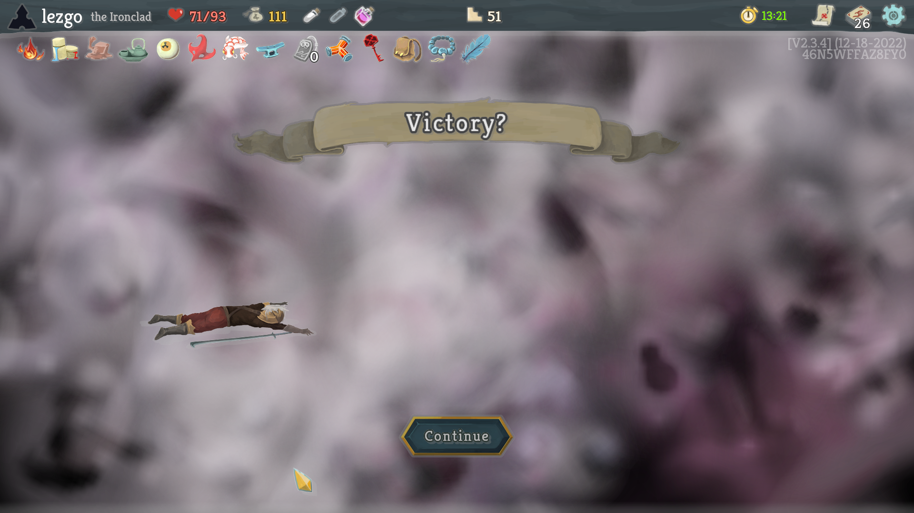
  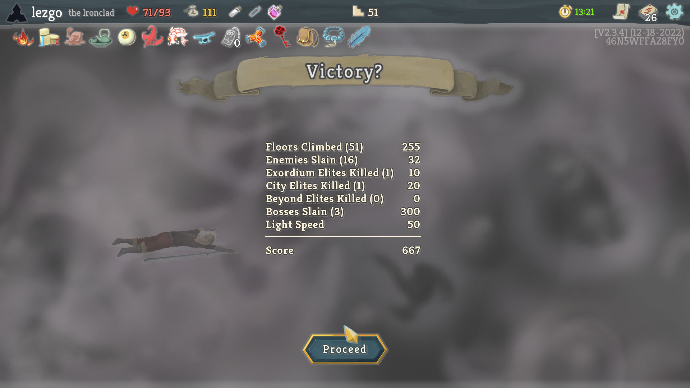
</p>

```text
# Unmodified Slay the Spire JVM stdout on Floor 51 Victory (Run #21, Seed: 46N5WFFAZ8FY0):
PLAYTIME: 801
unlockAchievement: SHAPES
unlockAchievement: SPEED_CLIMBER
unlockAchievement: RUBY
```

---

## 🌐 Live Links & Telemetry Datasets

- **Interactive GitHub Pages Dashboard**: [https://yakiebi.github.io/slay-the-spire-ironclad-ai/](https://yakiebi.github.io/slay-the-spire-ironclad-ai/)
- **Live Google Spreadsheet (6 Tabs + Native Charts)**: [Slay the Spire — Ironclad AI Experiment Telemetry (21 Runs)](https://docs.google.com/spreadsheets/d/1QaTf-T1JtgsI-HPnWZleRwBCAV4ktXWXr7AtER40xrI/edit)
- **Download Multi-Tab Excel Workbook (`.xlsx`)**: [`data/slay_the_spire_ironclad_experiment.xlsx`](data/slay_the_spire_ironclad_experiment.xlsx)

---

## 🎨 Visual Infographic: 21-Run Statistical Experiment & Core Synergies

Below is a visual summary of the experiment's telemetry, card draft mechanics, relic synergies, and boss counter-heuristics across all 21 runs:

### 1. Key Card Pick-Rates & In-Game Card Art (Top Archetype Engines)

| Card Asset | Card Name | Pick Rate (%) | Times Offered | Times Picked | AI Valuation & Combat Role |
| :---: | :--- | :---: | :---: | :---: | :--- |
| 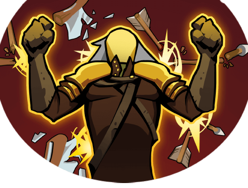 | **Feel No Pain**<br>`Power • Uncommon` | **`100.0%`** | 3 | 3 | **Primary Block Engine**: +3 (4) Block whenever any card is exhausted. Infinite block scaling with *Corruption* & *Second Wind*. |
| 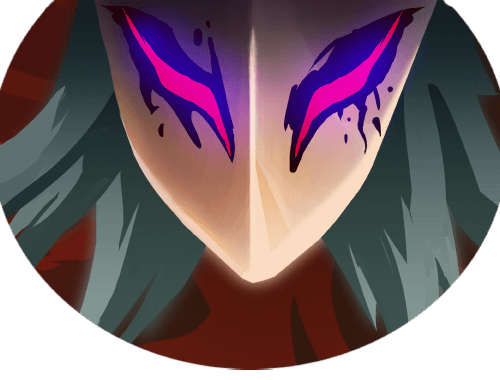 | **Corruption**<br>`Power • Rare` | **`66.7%`** | 3 | 2 | **Energy Acceleration Engine**: All Skills cost 0 Energy and exhaust. Paired with *Snecko Eye* for unstoppable free turns. |
| 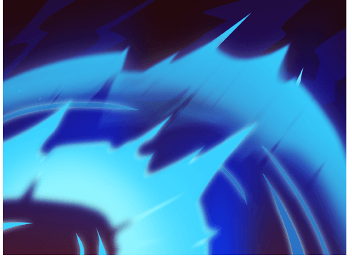 | **Shockwave**<br>`Skill • Uncommon` | **`76.5%`** | 17 | 13 | **Universal Debuff Engine**: 3 (5) turns of Weak & Vulnerable to ALL enemies. Top priority debuff before heavy attack bursts. |
|  | **Uppercut**<br>`Attack • Uncommon` | **`53.3%`** | 15 | 8 | **Boss Execution & Debuff**: 13 damage + 1 (2) Weak & Vulnerable. Strips Artifact and sets up turn-2 boss kills. |
| 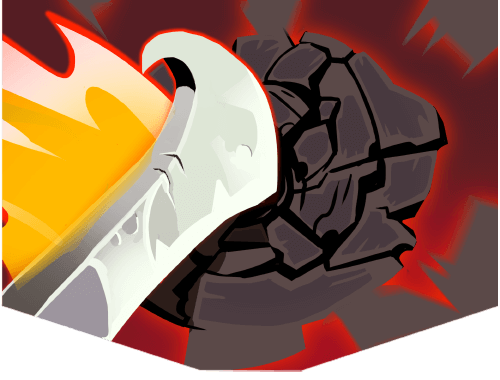 | **Heavy Blade**<br>`Attack • Common` | **`64.5%`** | 31 | 20 | **Strength Finisher**: 14 damage; scales with 3x (5x) Strength multiplier. Primary damage dealer in Boss encounters. |
|  | **Body Slam**<br>`Attack • Common` | **`61.5%`** | 26 | 16 | **Offensive Block Converter**: Deals damage equal to current Block. Upgrades to 0-cost; deals 40–90 damage after big block turns. |
| 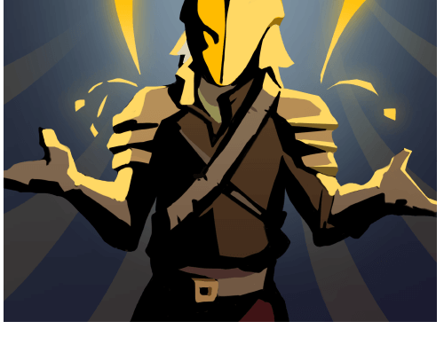 | **Shrug It Off**<br>`Skill • Common` | **`62.5%`** | 32 | 20 | **Consistent Cycling & Guard**: 8 (11) Block + draws 1 card. High draft priority across all 21 runs. |
| 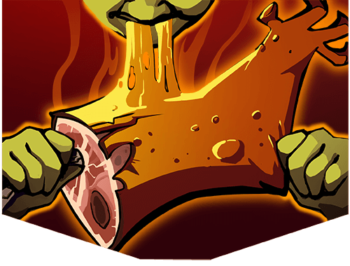 | **Feed**<br>`Attack • Rare` | **`66.7%`** | 3 | 2 | **Endgame Max HP Scaler**: Fatal kills permanently raise Max HP by +3 (+4). Scaled Max HP from 80 to 93 in Run #21! |
| 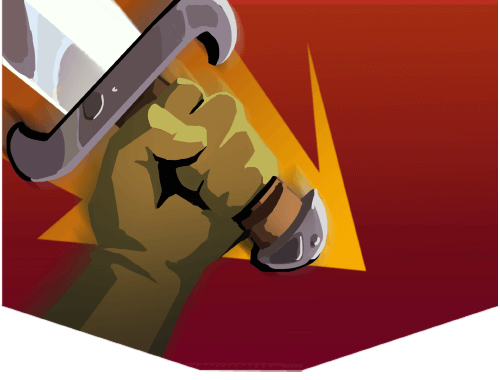 | **Pommel Strike**<br>`Attack • Common` | **`54.8%`** | 31 | 17 | **Damage + Card Draw**: 9 (10) damage + draws 1 (2) cards. Vital for digging into Power cards and fetching discarded cards. |
| 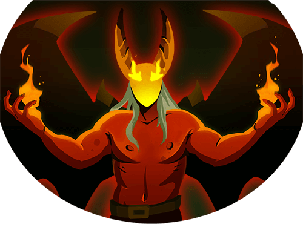 | **Demon Form**<br>`Power • Rare` | **`60.0%`** | 5 | 3 | **Passive Scaling Power**: Grants +2 (+3) Strength every turn. Guaranteed scaling win condition against Act 2 & 3 bosses. |

---

### 2. Core Relic Synergies (From Game Assets)

| Relic Asset | Relic Name | Rarity | Runs Obtained | Strategic Value in AI Heuristics |
| :---: | :--- | :---: | :---: | :--- |
|  | **Snecko Eye** | Boss | 4 | **Decisive Win Engine**: +2 card draw per turn (`7-card hands`). Confuses card costs `0–3`. `play_ironclad.py` prioritizes high-cost attacks (`Heavy Blade`, `Uppercut`, `Demon Form`) and Skills (`Corruption` overrides all Skill costs to 0!). |
|  | **Burning Blood** | Starter | 21 (100%) | **Passive Sustain**: Heals 6 HP at the end of every combat. Allows the bot to draft aggressive self-damage cards (*Hemokinesis*, *Offering*) without losing net HP. |
|  | **Cursed Key** | Boss | 3 | **+1 Energy per Turn**: Crucial for casting 4-cost combo hands. Paired with *Omamori* to open Act 3 chests with zero curse penalty. |
|  | **War Paint** | Common | 5 | **Early Defense Boost**: Upgrades 2 random Skills instantly at Floor 0 (*Neow's Blessing* in Run #21 upgraded 2 *Defends*). |
| 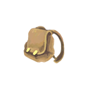 | **Bag of Preparation** | Common | 4 | **Turn 1 Explosiveness**: Draws 2 additional cards on Turn 1. Combined with *Snecko Eye* for a **9-card opening hand** on Floor 50! |
|  | **Horn Cleat** | Uncommon | 3 | **Turn 2 Stabilization**: Provides 14 Block on Turn 2, precisely when Act 3 Bosses (*Donu & Deca*) unleash 26 incoming damage. |
|  | **Eternal Feather** | Uncommon | 2 | **Campfire Healing Without Resting**: Restores +3 HP per 5 cards in deck at rest sites, freeing the bot to *Smith* upgrades at every fire. |

---

### 3. Aggregate Experiment Infographics Summary

```
========================================================================================
                      SLAY THE SPIRE — 21-RUN EXPERIMENT INFOGRAPHIC
========================================================================================

  TOTAL PLAYTIME            TOTAL COMBATS           CARDS EVALUATED         PEAK MAX HP
   4h 33m 50s                 354 Combats             326 / 1,018             93 Max HP
  (Avg 13m 02s/run)         (16.9 per run)           (32.0% Pick Rate)     (Seed: 46N5WFFAZ8FY0)

────────────────────────────────────────────────────────────────────────────────────────
  PROGRESSION BY DEVELOPMENT PHASE (v1.0 -> v2.3)
────────────────────────────────────────────────────────────────────────────────────────

  [Phase 1] Runs #1–#3   (v1.0–v1.2): ░░░░░░░░░░░░░░░░░░░░  Floor 14 Max (Early Act 1 WIP)
  [Phase 2] Runs #4–#7   (v1.3–v1.5): ████████░░░░░░░░░░░░  Floor 23 Max (Act 1 Boss Cleared)
  [Phase 3] Runs #8–#12  (v1.6–v1.8): ████████████░░░░░░░░  Floor 33 Max (Act 2 Boss Cleared)
  [Phase 4] Runs #13–#17 (v1.9–v2.1): ████████████████░░░░  Floor 42 Max (Late Act 3 Reached)
  [Phase 5] Runs #18–#21 (v2.2–v2.3): ████████████████████  Floor 51 VICTORY! (13m 21s Clear!)
                                                            • 100% Act 3 Reach (4/4 runs)
                                                            • 75% Floor 50 Boss Reach (3/4 runs)

────────────────────────────────────────────────────────────────────────────────────────
  DEADLIEST MONSTER ENCOUNTERS (Top Damage Taken per Fight Across 354 Encounters)
────────────────────────────────────────────────────────────────────────────────────────

  1. Time Eater (Boss)       [Floor 50]  ████████████████████ 44.5 Avg Dmg Taken (2 fights)
  2. The Guardian (Boss)     [Floor 16]  ████████████░░░░░░░░ 28.3 Avg Dmg Taken (6 fights)
  3. Awakened One (Boss)     [Floor 50]  ███████████░░░░░░░░░ 26.0 Avg Dmg Taken (1 fight)
  4. Lagavulin (Elite)       [Floor 7]   █████████░░░░░░░░░░░ 21.4 Avg Dmg Taken (7 fights)
  5. Book of Stabbing (Elite)[Floor 23]  ████████░░░░░░░░░░░░ 18.2 Avg Dmg Taken (5 fights)
  6. Nemesis (Elite)         [Floor 40]  ███████░░░░░░░░░░░░░ 16.5 Avg Dmg Taken (4 fights)
  7. Donu and Deca (Boss)    [Floor 50]  ██████░░░░░░░░░░░░░░ 13.0 Dmg Taken (SLAIN Turn 7!)
========================================================================================
```

---

## 🔥 Floor 50 Decision Log: Exploiting `Corruption` + `Snecko Eye` & Bypassing `Time Warp`

### 1. Donu & Deca Turn 1 & Turn 2 Execution (`run_history.log`, Run #21)
Entering Floor 50 at **`93/93 HP`** with **`Snecko Eye`** (+2 card draw per turn, randomized card costs `0–3`), **`Bag of Preparation`** (+2 draw on Turn 1), **`Lantern`** (+1 Energy on Turn 1), **`Cursed Key`** (4 base Energy), and **`Mutagenic Strength`** (+3 Strength on Turn 1), the bot drew a 9-card opening hand against **Deca** (`250 HP`) and **Donu** (`250 HP`).

Below is the actual console execution log from [`run_history.log`](run_history.log) (lines 13165–13223):

```text
[04:03:28] Saved screenshot: act3_boss_floor50.png
[04:03:28] Floor 50 (MonsterRoomBoss) Turn 1: HP=93/93 Blk=0 E=6 Incoming=20 | Enemies: Deca(250+0HP, ATTACK_DEBUFF 10x2), Donu(250+0HP, BUFF -1x1)
[04:03:28] Combat: Opening Potion [1] Dexterity Potion
[04:03:28] Potion PopUp Open: Clicking top button (Use/Drink)
[04:03:29] Floor 50 Turn 1: Playing [4] Corruption (cost=0, target=-1, score=398.0)
[04:03:30] Floor 50 Turn 1: Playing [4] Feel No Pain (cost=0, target=-1, score=322.0)
[04:03:31] Floor 50 Turn 1: Playing [3] Defend+ (cost=0, target=-1, score=275.0)
[04:03:31] Floor 50 Turn 1: Playing [3] Uppercut+ (cost=1, target=1, score=216.0)
[04:03:32] Floor 50 Turn 1: Playing [4] Heavy Blade+ (cost=1, target=1, score=253.4)
[04:03:33] Floor 50 Turn 1: Playing [2] Blood for Blood (cost=1, target=1, score=207.8)
[04:03:33] Floor 50 Turn 1: Playing [0] Feed (cost=0, target=1, score=172.2)
[04:03:34] Floor 50 Turn 1: Playing [1] Bash+ (cost=1, target=1, score=164.5)
[04:03:35] Floor 50 Turn 1: No playable cards left -> End Turn

[04:03:39] Floor 50 (MonsterRoomBoss) Turn 2: HP=89/93 Blk=17 E=4 Incoming=26 | Enemies: Deca(250+0HP, DEFEND 10x2), Donu(122+0HP, ATTACK 13x2)
[04:03:39] Floor 50 Turn 2: Playing [6] Shrug It Off+ (cost=0, target=-1, score=333.7)
[04:03:40] Floor 50 Turn 2: Playing [2] Body Slam+ (cost=0, target=1, score=286.2)
[04:03:40] Floor 50 Turn 2: Playing [3] Thunderclap (cost=1, target=-1, score=216.0)
[04:03:42] Floor 50 Turn 2: Playing [3] Headbutt (cost=0, target=1, score=149.4)
[04:03:42] Grid Select: Clicking card [0] Uppercut+ at (430.0, 705.2)
[04:03:43] Floor 50 Turn 2: Playing [1] Pommel Strike+ (cost=3, target=1, score=142.0)
[04:03:43] Floor 50 Turn 2: Playing [4] Heavy Blade (cost=0, target=1, score=179.8)
[04:03:44] Floor 50 Turn 2: Playing [3] Uppercut+ (cost=0, target=1, score=536.5)  <-- +360 Lethal Bonus! Donu SLAIN on Turn 2!
[04:03:44] Floor 50 Turn 2: Done playing cards -> End Turn

[04:03:47] Floor 50 (MonsterRoomBoss) Turn 3: HP=89/93 Blk=0 E=4 Incoming=26 | Enemies: Deca(246+16HP, ATTACK_DEBUFF 13x2)
[04:03:47] Floor 50 Turn 3: Playing [6] Uppercut+ (cost=0, target=0, score=258.0)
[04:03:47] Floor 50 Turn 3: Playing [4] Defend (cost=0, target=-1, score=252.5)
[04:03:48] Floor 50 Turn 3: Playing [0] Hemokinesis+ (cost=1, target=0, score=204.0)
[04:03:49] Floor 50 Turn 3: Playing [0] Twin Strike+ (cost=3, target=0, score=146.0)
[04:03:50] Floor 50 Turn 3: No playable cards left -> End Turn
...
[04:04:15] Floor 50 (MonsterRoomBoss) Turn 7: HP=65/93 Blk=0 E=4 Incoming=26 | Enemies: Deca(8+16HP, ATTACK_DEBUFF 13x2)
[04:04:15] Floor 50 Turn 7: Playing [6] Uppercut+ (cost=0, target=0, score=536.5)
[04:04:15] Floor 50 Turn 7: Playing [4] Headbutt (cost=0, target=0, score=509.4)   <-- Deca SLAIN! (+6 HP Burning Blood -> 71/93 HP)
[04:07:35] ==========================================
[04:07:35] VICTORY! Ironclad beat Slay the Spire!
[04:07:35] ==========================================
```

#### Why This Sequence Worked So Well
1. **Explicit `Corruption` + `Snecko Eye` Priority Boost (`score=398.0`)**: Normally, `play_ironclad.py` holds back `Corruption` on Turn 1 of `>220 HP` Boss fights so it doesn't exhaust all block skills prematurely. However, when `has_relic(player, "Snecko Eye")` is true, `handle_combat` overrides that restriction and adds a **`+75.0` priority bonus** to `Corruption` because `Corruption` forces every Skill drawn by `Snecko Eye` (`Defend+`, `Shrug It Off+`) to **cost `0 Energy` regardless of `Confusion`**, while exhausting them triggers `Feel No Pain` (`+3 Block` per Skill).
2. **Focus-Firing *Donu* (`target=1`)**: The target evaluator prioritizes *Donu* over *Deca* because *Donu* casts *Circle of Power* (`+3 Strength` to both bosses every even turn). Applying `Uppercut+` first stripped *Donu*'s `Artifact` stacks and enabled `Bash+` to land `Vulnerable`, dealing **128 damage on Turn 1** (`250 -> 122 HP`).
3. **Turn 2 `Headbutt` → `Pommel Strike+` → `0-Cost Uppercut+` Lethal Chain (`score=536.5`)**:
   - On Turn 2, `Shrug It Off+` (`cost=0` via `Corruption`) + `Feel No Pain` + `Horn Cleat` (`+14 Block` on Turn 2) built **31 Block**, turning the `0-cost Body Slam+` (`score=286.2`) into a 46-damage nuke before `Thunderclap` stripped *Donu*'s last `Artifact` and applied `Vulnerable`.
   - When `Headbutt` (`cost=0`) triggered `GridCardSelectScreen` on the discard pile, `handle_grid_select` selected the highest-scored attack (`Uppercut+`) and placed it on top of the draw pile.
   - Next, `Pommel Strike+` (`cost=3`, draws 2 cards) immediately drew that `Uppercut+` back into hand, where `Snecko Eye` rolled its cost to **`0 Energy`**!
   - After `Heavy Blade` (`cost=0`), `Uppercut+` saw `eff_card_dmg >= Donu.currentHealth` and received the **`+360.0` universal lethal post-score bonus** (`score=536.5`), killing *Donu* on Turn 2 and turning the rest of the boss fight into a 1v1 against *Deca*.

---

### 2. How the Bot Bypasses *Time Eater*'s `Time Warp` Counter & `Haste` Turn
In Runs #19 and #20, the bot reached Floor 50 against **Time Eater** (`456 HP`), exposing two classic AI traps:
1. Ending a turn with the `Time Warp` counter at `9/12`, `10/12`, or `11/12`—which traps the bot into a 1-to-3 card turn on the following turn when *Time Eater* attacks for `45+` damage.
2. Dumping multi-hit attacks and debuffs into *Time Eater* when it is below `50% HP` (`< 228 HP`) and showing `intent == "BUFF"` (*Haste*), which heals *Time Eater* back to `228 HP` and cleanses all debuffs.

Here is the exact heuristic added in `v2.3` ([`play_ironclad.py`](play_ironclad.py#L1268-L1282)) that solved both mechanics:

```python
# Time Eater specific card-count & Haste discipline (play_ironclad.py, lines 1268-1282):
if time_eater and not is_lethal_hit:
    # 1. Never spam low-impact 0-cost cards into the Time Warp 12-card counter
    if cid in ("Anger", "Madness"):
        continue

    # 2. On Time Eater's <50% HP Haste (BUFF) turn, it heals back to 228 HP and clears all debuffs!
    #    Do NOT waste Attacks, debuffs, or draw/exhaust cards into Haste — only play permanent Powers or Limit Break!
    if time_eater.get("intent") == "BUFF" and time_eater.get("currentHealth", 999) < 228:
        if ctype != "POWER" and cid != "Limit Break":
            continue

    # 3. Time Warp Counter Discipline:
    #    - Stop early at 6..8 cards ONLY when all incoming damage is already blocked (unblocked_dmg == 0),
    #      leaving a clean 4..6 card allowance for the next turn.
    #    - NEVER stop at 9, 10, or 11 if we have playable cards — push through to 12/12 on the current turn
    #      so the counter resets to 0/12 for the start of the next turn!
    if 6 <= time_warp_cnt <= 8 and unblocked_dmg == 0 and ctype != "POWER" and cid != "Limit Break":
        continue
```

---

## 🔧 Setup & Hooking Guide: Compiling & Attaching `StsObserverAgent.java` to the LibGDX Render Thread

If you want to reproduce, fork, or build your own agent on top of *Slay the Spire*, the hardest engineering challenge is that **LibGDX (`com.badlogic.gdx`) and Slay the Spire's `GameActionManager` are strictly single-threaded**. Calling game methods or reading OpenGL framebuffers directly from an external thread (such as an HTTP server thread) causes immediate race conditions, `NullPointerException`s inside `CardGroup`, or fatal `GLException: No OpenGL context found in the current thread` crashes.

Here is how [`observer/StsObserverAgent.java`](observer/StsObserverAgent.java) solves this cleanly without *ModTheSpire* or bytecode patching.

### 1. How the `-javaagent` Hook Works
1. **JVM `premain` Entrypoint**: Before `com.megacrit.cardcrawl.desktop.DesktopLauncher.main()` starts, the JVM invokes `StsObserverAgent.premain(String agentArgs, Instrumentation inst)`, which spins up a lightweight daemon `com.sun.net.httpserver.HttpServer` on `127.0.0.1:17575`.
2. **Bridging HTTP Threads to the LibGDX Render Loop via `Gdx.app.postRunnable` + `CountDownLatch`**:
   Whenever an HTTP request arrives on `/action` or `/screenshot`, the HTTP handler schedules a `Runnable` onto LibGDX's main render loop via `Gdx.app.postRunnable(...)` and awaits a `CountDownLatch` so the action executes **synchronously between frames** on the exact thread that owns the OpenGL context and `AbstractDungeon.actionManager`:

```java
// Excerpt from observer/StsObserverAgent.java (lines 186-227)
// Safely queuing a card play onto GameActionManager.cardQueue from an HTTP worker thread:
final int cardIndex = Integer.parseInt(q.get("cardIndex"));
final int targetIndex = q.containsKey("targetIndex") ? Integer.parseInt(q.get("targetIndex")) : -1;
final CountDownLatch latch = new CountDownLatch(1);
final String[] status = new String[]{"ok"};

Gdx.app.postRunnable(new Runnable() {
    @Override
    public void run() {
        try {
            AbstractPlayer p = AbstractDungeon.player;
            AbstractCard card = p.hand.group.get(cardIndex);
            AbstractMonster target = (targetIndex >= 0)
                    ? AbstractDungeon.getCurrRoom().monsters.monsters.get(targetIndex)
                    : null;

            if (!card.canUse(p, target)) {
                status[0] = "cannot_use:" + card.cantUseMessage;
                return;
            }
            // Move in-game cursor to the target hitbox and push onto the official cardQueue
            if (target != null && target.hb != null) {
                Gdx.input.setCursorPosition(Math.round(target.hb.cX), Settings.HEIGHT - Math.round(target.hb.cY));
            }
            AbstractDungeon.actionManager.cardQueue.add(new CardQueueItem(card, target));
        } catch (Throwable t) {
            status[0] = "err:" + t.toString();
        } finally {
            latch.countDown();
        }
    }
});
latch.await(2, TimeUnit.SECONDS);
```

3. **Coordinate-Space Translation & 3-Frame Click Injection**:
   *Slay the Spire* hitboxes (`hb.cX`, `hb.cY`) use **bottom-left origin** (`y = 0` at bottom, `y = 1080` at top), whereas `Gdx.input.setCursorPosition(screenX, screenY)` uses **top-left window origin** (`screenY = Settings.HEIGHT - Math.round(cy)`). To ensure every button/hitbox registers hover before click, `cmd=click` posts three sequential runnables across frames (`hover` → `50ms` → `InputHelper.touchDown = true` → `50ms` → `InputHelper.touchUp = true`).

### 2. Compiling `sts_observer.jar` from Source
A pre-compiled [`observer/sts_observer.jar`](observer/sts_observer.jar) is already included in the repository. If you modify [`observer/StsObserverAgent.java`](observer/StsObserverAgent.java), you can recompile it against *Slay the Spire*'s `desktop-1.0.jar` (which already bundles LibGDX and Gson) in one command:

```powershell
# Option A: Use the included build script
.\build_observer_jar.bat

# Option B: Manual javac + jar commands (requires JDK 8+)
cd observer
$STS_JAR = "C:\Program Files (x86)\Steam\steamapps\common\SlayTheSpire\desktop-1.0.jar"

# 1. Compile targeting Java 8 bytecode (since Slay the Spire's bundled JRE is Java 8)
javac -source 8 -target 8 -cp "$STS_JAR" StsObserverAgent.java

# 2. Package with MANIFEST.MF (which declares Premain-Class: StsObserverAgent)
jar cfm sts_observer.jar MANIFEST.MF StsObserverAgent*.class
```

Where [`observer/MANIFEST.MF`](observer/MANIFEST.MF) contains:
```text
Manifest-Version: 1.0
Premain-Class: StsObserverAgent
Can-Redefine-Classes: true
Can-Retransform-Classes: true
```

---

## 🚀 How to Install & Run the Bot (3 Steps)

### Prerequisites
1. **Slay the Spire** installed via Steam (default path: `C:\Program Files (x86)\Steam\steamapps\common\SlayTheSpire`).
   - *Note*: Steam's *Slay the Spire* comes bundled with its own Java 8 runtime (`jre\bin\java.exe`), so you do **not** even need Java installed globally to run the prebuilt `sts_observer.jar`!
2. **Python 3.8+** (uses only the Python standard library: `urllib.request`, `json`, `time`, `re`, `os`—no `pip install` required!).

### Step 1: Clone the Repository
```powershell
git clone https://github.com/yakiebi/slay-the-spire-ironclad-ai.git
cd slay-the-spire-ironclad-ai
```

### Step 2: Launch *Slay the Spire* with the Observer Agent Attached
Make sure Steam is running, then double-click **`launch_sts_with_agent.bat`** or run:

```powershell
# Default Steam path:
.\launch_sts_with_agent.bat

# Or if installed in a custom SteamLibrary folder:
$env:STS_DIR = "D:\SteamLibrary\steamapps\common\SlayTheSpire"
.\launch_sts_with_agent.bat
```

*(Under the hood, this runs `.\jre\bin\java.exe -Xmx1G -javaagent:...\observer\sts_observer.jar -jar desktop-1.0.jar` and starts the local bridge on `http://127.0.0.1:17575`.)*

Verify the bridge is live by opening [http://127.0.0.1:17575/state](http://127.0.0.1:17575/state) in your browser.

### Step 3: Start the Autonomous Ironclad Bot
In a second terminal window, run:

```powershell
python play_ironclad.py
```

The bot will automatically navigate from the Main Menu (or resume an in-progress run), select **The Ironclad**, take Neow's Blessing, and play through Acts 1–3 in real time while printing turn-by-turn decisions to the console and `run_history.log`.

---

## 🛠️ How to Edit, Customize, or Train Your Own Bot

### 1. Tuning Card Draft & Shop Priorities (`play_ironclad.py`)
Open [`play_ironclad.py`](play_ironclad.py) and inspect:
- **`CARD_SCORES` (lines 70–160)**: Base tier values (`0–100`) for every Ironclad and Colorless card. Increase a card's score to draft it more aggressively, or lower it below `56` (the skip threshold) to skip it unless upgraded/synergistic.
- **`evaluate_card_for_deck(card, state)` (lines 195–275)**: Dynamic synergy adjustments based on your current `masterDeck` and `relics`.

### 2. Modifying Combat Card Sequencing (`handle_combat` in `play_ironclad.py`)
`handle_combat(self, st)` loops over every playable card in `player["hand"]` (`canUse == True`) and computes a priority score `sc` across 5 stages:
1. **0-Cost Setup / Energy / Upgrade (`250–400`)**: `Apotheosis`, `Offering`, `Seeing Red`, `Armaments`, `Battle Trance`, `Rage`, `Flex`.
2. **Powers & Scaling (`235 + base`)**: `Corruption` (`+75` with `Snecko Eye`), `Feel No Pain`, `Demon Form`, `Inflame`, `Metallicize`, `Spot Weakness`, `Limit Break`.
3. **Debuffs Before Attacks (`238–285`)**: `Shockwave`, `Disarm`, `Clothesline`, `Uppercut`, `Bash`, `Thunderclap`, `Intimidate`.
4. **Urgency-Weighted Block (`135–310+`)**: Scales with `min(blk, unblocked_dmg) * 7.5` plus a `+65` urgency boost when `unblocked_dmg >= 12`, `HP <= 50`, or in Boss fights.
5. **Universal Post-Scoring (`+360` Lethal / `+250` Fatal `Feed`)**: Checks `eff_card_dmg * hits >= enemy_hp + enemy_block` across all attacks, while penalizing suicide into `Thorns` (`Spiker`) or 2-cost attacks into `Intangible` (`Nemesis`).

### 3. Modifying Map Routing (`handle_map` in `play_ironclad.py`)
`score_node(n, depth)` inside `handle_map` evaluates a **3-floor lookahead tree** (`s += 0.65 * max(child_scores)`) over the dungeon map nodes (`R` Rest, `E` Elite, `$` Shop, `T` Treasure, `?` Event, `M` Monster). You can edit node weights to hunt more Elites or route toward the Burning Elite (`n.get("hasEmeraldKey") == True`) for Act 4 Heart runs.

### 4. Building Your Own RL / Imitation Learning / LLM Agent via the HTTP JSON API
Because `StsObserverAgent` exposes a language-agnostic HTTP JSON API on `http://127.0.0.1:17575`, you can write your own agent in **Python (PyTorch / Gymnasium / Stable-Baselines3)**, **TypeScript**, **Rust**, or **Go**, or connect an **LLM agent**:

| Endpoint | Method | Parameters / Description |
| :--- | :---: | :--- |
| `/state` | `GET` | Returns full JSON snapshot of `mode`, `dungeon`, `room`, `actionManager`, `player` (HP, energy, hand, deck, relics, potions, powers), `monsters` (HP, intent, powers), `overlay`, `map`, `shop`, `event`, `combatRewards`, `cardReward`, `bossRelics`, `gridSelect`, `handSelect`, `gameOver`. |
| `/action?cmd=play_card&cardIndex=<i>&targetIndex=<m>` | `GET` | Plays hand card at `cardIndex` targeting monster `targetIndex` (`-1` for self/AoE/untargeted cards). |
| `/action?cmd=end_turn` | `GET` | Clicks the End Turn button (`EndTurnButton.hb.clicked = true`). |
| `/action?cmd=click&x=<cx>&y=<cy>` | `GET` | Moves cursor to `(x, y)` in 1920×1080 space and performs a 3-stage hover/touchDown/touchUp click on the LibGDX thread. |
| `/action?cmd=hand_select&cardIndex=<i>` | `GET` | Selects card `i` in `HandCardSelectScreen` (Armaments, True Grit, Dual Wield, Gambling Chip). |
| `/action?cmd=scroll&dir=<up\|down>&steps=<n>` | `GET` | Scrolls the Dungeon Map or Grid Select screen (`InputHelper.scrolledUp / scrolledDown`). |
| `/screenshot?path=<abs_path.png>` | `GET` | Captures a 1920×1080 PNG screenshot directly from the OpenGL framebuffer (`ScreenUtils.getFrameBufferPixmap`). |

### 5. Regenerating the Telemetry Spreadsheets & GitHub Pages Data
After running your own experiments, run [`generate_experiment_assets.py`](generate_experiment_assets.py) to parse all `.run` files from your *Slay the Spire* `runs\IRONCLAD` folder and automatically update [`data/`](data/), [`docs/data/`](docs/data/), and [`docs/data.js`](docs/data.js):

```powershell
python generate_experiment_assets.py
```

---

## 📊 Google Sheets & CSV Spreadsheets

- **Live Google Spreadsheet (in Google Drive)**: [Slay the Spire — Ironclad AI Experiment Telemetry (21 Runs)](https://docs.google.com/spreadsheets/d/1QaTf-T1JtgsI-HPnWZleRwBCAV4ktXWXr7AtER40xrI/edit)
- **Multi-Tab OpenXML Workbook (`.xlsx`)**: [`data/slay_the_spire_ironclad_experiment.xlsx`](data/slay_the_spire_ironclad_experiment.xlsx)
- **Individual CSV Datasets**:
  - [`data/runs_summary.csv`](data/runs_summary.csv) — All 21 runs (floor reached, outcome, playtime, deck size, relics, gold, killer)
  - [`data/card_pick_rates.csv`](data/card_pick_rates.csv) — All 69 cards offered across 1,018 reward slots
  - [`data/relics_obtained.csv`](data/relics_obtained.csv) — All 63 relics obtained/offered
  - [`data/iterations_changelog.csv`](data/iterations_changelog.csv) — All 12 AI engineering iterations (`v1.0` → `v2.3`)
  - [`data/enemy_damage_summary.csv`](data/enemy_damage_summary.csv) — Aggregated combat difficulty across 37 enemy groups
  - [`data/combat_encounters.csv`](data/combat_encounters.csv) — All 354 individual combat encounters

---

## 🏆 Experiment Summary Metrics

| Metric | Value | Notes |
| :--- | :--- | :--- |
| **Total Runs** | `21` | Chronological runs from `v1.0` baseline to `v2.3` victory |
| **Total Playtime** | `4h 33m 50s` (`16,430s`) | Avg `13m 02s` (`782s`) per run |
| **Total Combats Fought** | `354` | Across Acts 1, 2, and 3 |
| **Total Cards Offered / Picked** | `326 / 1,018` | `32.0%` per-card selection rate across 340+ reward screens |
| **Act 3 Reach Rate (Phase 5, Runs #18–#21)** | `100%` (`4 / 4`) | Reached Floor 46, 50, 50, and 51 (Victory!) |
| **Floor 50 Boss Reach Rate (Phase 5)** | `75%` (`3 / 4`) | `Time Eater` (x2) and `Donu and Deca` (Victory!) |
| **Winning Run (#21) Time & Score** | `13m 21s` (`801s`) • `667 pts` | Unlocked `SPEED_CLIMBER`, `SHAPES`, and `RUBY` |
